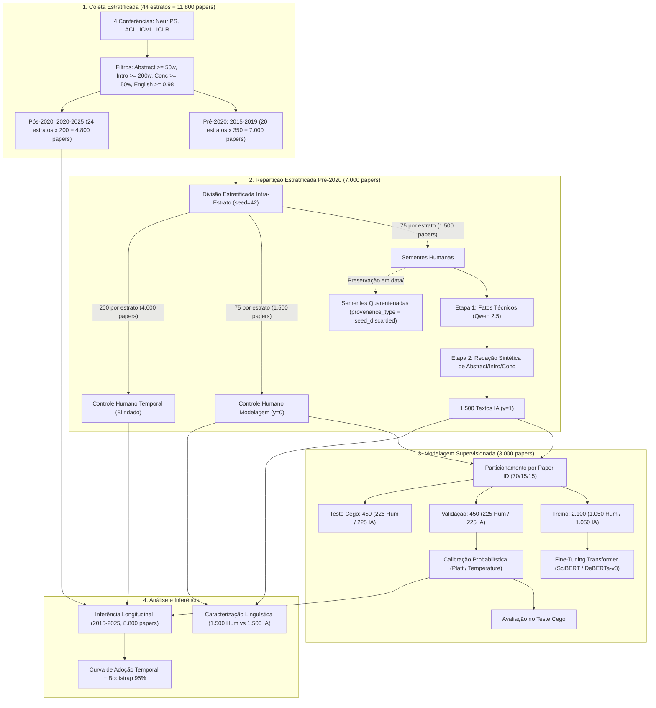

# Especificação Técnica do Sistema: Detecção de IA na Literatura Científica, Modelagem Transformer e Série Temporal

## 1. Escopo e Parâmetros Centrais

* **Conferências Alvo:** NeurIPS, ACL, ICML, ICLR (estritamente 4 eventos).
* **Cobertura Temporal:** 2015 a 2025 (11 edições consecutivas).
* **Marco Temporal de Segurança:** 2020 (artigos humanos restritos a publicações $\le 2019$).
* **Idioma:** Inglês (validação automatizada).
* **Granularidade Textual:** Exclusivamente seções de Abstract, Introdução e Conclusão.
* **Cota de Coleta:** 350 artigos por estrato no Pré-2020 ($\le 2019$) e 200 artigos por estrato no Pós-2020 ($\ge 2020$).
* **Volume Global Coletado:** 11.800 artigos ($20 \times 350 + 24 \times 200 = 7.000 + 4.800$).



---

## 2. Metodologia de Amostragem e Coleta

### 2.1 Amostragem Aleatória Estratificada Intra-Estrato
Para cada par `(conferência, ano)`:
1. **Filtros de Qualidade e Elegibilidade:**
   * Apenas artigos completos da trilha principal (*main track*).
   * Exclusão de workshops, demonstrações de software, tutoriais, resumos estendidos e erratas.
   * Presença obrigatória de texto nas três seções: Abstract $\ge 50$ palavras, Introdução $\ge 200$ palavras, Conclusão $\ge 50$ palavras.
   * Confirmação de língua inglesa via classificador (`fasttext` ou `langdetect` com escore $\ge 0.98$).
2. **Seleção Intra-Estrato:** Amostragem aleatória uniforme sem reposição (*Simple Random Sampling*) com semente pseudoaleatória fixada (`seed = 42`) sobre o conjunto de artigos elegíveis filtrados, retirando até 350 artigos por estrato no pré-2020 e 200 no pós-2020.

### 2.2 Dimensionamento dos Estratos e Alocação dos Artigos

| Período | Anos | Conferências | Estratos | Cotas por Estrato | Total Coletado | Destinação e Subdivisão |
| :--- | :--- | :--- | :--- | :--- | :--- | :--- |
| **Pré-2020** | 2015-2019 (5 anos) | NeurIPS, ACL, ICML, ICLR (4) | 20 | 350 papers/estrato | 7.000 | 1.500 Sementes IA ($S_{\text{seed}}$, 75/estrato)<br/>1.500 Modelagem Humana ($S_{\text{human}}$, 75/estrato)<br/>4.000 Temporal Humano ($S_{\text{temporal}}$, 200/estrato) |
| **Pós-2020** | 2020-2025 (6 anos) | NeurIPS, ACL, ICML, ICLR (4) | 24 | 200 papers/estrato | 4.800 | Avaliação longitudinal temporal não rotulada (800 papers/ano) |
| **Total** | 2015-2025 (11 anos) | 4 conferências | 44 | 350 pré / 200 pós | **11.800** | Corpus bruto total coletado |

### 2.3 Protocolo de Descarte de Sementes e Blindagem Temporal
1. **Subconjunto Semente ($S_{\text{seed}}$, 1.500 artigos):** Selecionado de forma balanceada (75 por estrato no pré-2020). Alimentado na LLM Qwen 2.5 em duas etapas para produzir as 1.500 contrapartes sintéticas ($S_{\text{synthetic}}$, $y = 1$).
2. **Preservação para Auditoria e Quarentena Experimental (`seed_discarded`):** Os textos humanos originais de $S_{\text{seed}}$ são preservados em disco no diretório `data/` com o atributo `provenance_type = 'seed_discarded'` (armazenados em `data/processed/seeds_discarded.jsonl`). Não devem ser excluídos fisicamente do disco em hipótese alguma, garantindo rastreabilidade e reprodutibilidade científica. O descarte é estritamente experimental: nenhum artigo de $S_{\text{seed}}$ participa do treino, validação, teste ou série temporal.
3. **Subconjunto de Modelagem Humana ($S_{\text{human}}$, 1.500 artigos):** Selecionado de forma balanceada (75 por estrato no pré-2020). Constitui a classe humana pura ($y = 0$) para o desenvolvimento do modelo e caracterização linguística.
4. **Subconjunto Temporal Blindado ($S_{\text{temporal}}$, 4.000 artigos):** Selecionado de forma balanceada (200 por estrato no pré-2020, totalizando 800 artigos por ano). Permanece estritamente blindado e isolado de todas as rotinas de treino, validação cruzada ou calibração do modelo, assegurando que a avaliação histórica na série temporal seja 100% fora da amostra (*out-of-sample*) com perfeita simetria em relação aos 800 artigos/ano do pós-2020.

### 2.4 Modelo Oficial para Síntese Acadêmica
* **Modelo Designado:** `Qwen/Qwen2.5-7B-Instruct` (pesos abertos da Alibaba).
* **Justificativa:** Desempenho de ponta em raciocínio técnico, seguimento estrito de diretrizes acadêmicas, densidade informacional e domínio de terminologia científica formal em língua inglesa. Permite execução em 2 a 3 horas via `vLLM` em GPU de 16 GB (como Google Colab T4 gratuita).

---

## 3. Esquema Formal de Dados (`.jsonl`)

Armazenamento linha a linha em UTF-8.

| Atributo | Tipo | Restrição / Formato |
| :--- | :--- | :--- |
| `paper_id` | `string` | Identificador único persistente. Prioridade: DOI formal. Fallback: Venue ID (ex: ACL ID, OpenReview ID, PMLR ID) ou `sha256(conference_year_title)`. |
| `doi` | `string \| null` | DOI oficial registrado na CrossRef/DataCite. |
| `title` | `string` | Título original completo. |
| `authors` | `list[string]` | Nomes dos autores. |
| `publication_year` | `integer` | Ano nos anais (2015 a 2025). |
| `conference` | `string` | `NeurIPS`, `ACL`, `ICML`, `ICLR`. |
| `url` | `string` | Link direto para PDF ou página canônica do artigo. |
| `abstract` | `string` | Texto limpo do resumo. |
| `introduction` | `string` | Texto limpo da introdução. |
| `conclusion` | `string` | Texto limpo da conclusão. |
| `section_lengths` | `dict[string, int]` | `abstract_words`, `intro_words`, `conclusion_words`, `total_words`. |
| `provenance_type` | `string` | `human_ground_truth`, `synthetic_ai`, `seed_discarded`, `human_temporal_blind`, `longitudinal_unlabeled`. |
| `label` | `int \| null` | `0` (Humano), `1` (IA), ou `null` (temporal não rotulado). |
| `generator_metadata` | `dict \| null` | Metadados do gerador (`model_name`, `temperature`, `top_p`, `prompt_id`, `timestamp`). Preenchido apenas para $y=1$. |

---

## 4. Modelagem Supervisionada (Transformer Encoder)

### 4.1 Conjunto de Modelagem (3.000 artigos)
Particionamento estrito no nível de `paper_id`:
* **Treino (70%):** 2.100 artigos (1.050 Humanos, 1.050 IA).
* **Validação (15%):** 450 artigos (225 Humanos, 225 IA), para ajuste de limiares e calibração de probabilidades.
* **Teste Cego (15%):** 450 artigos (225 Humanos, 225 IA), blindado de qualquer busca de hiperparâmetros ou calibração.

### 4.2 Arquiteturas Candidatas
* **SciBERT (`allenai/scibert_scivocab_uncased`):** Pré-treinado em literatura científica de computação.
* **DeBERTa-v3 (`microsoft/deberta-v3-base`):** Atenção desacoplada e regularização adversarial.
* **RoBERTa (`roberta-base`):** Linha de base clássica consolidada.

### 4.3 Treinamento e Calibração
* **Entrada:** `[ABSTRACT] {abstract} [INTRO] {intro} [CONCLUSION] {conclusion}` (truncamento posicional a 512 ou 1024 tokens).
* **Otimizador:** AdamW, taxa de aprendizado 1e-5 a 3e-5, decaimento de peso 0.01, aquecimento linear nos primeiros 10% dos passos.
* **Calibração Probabilística:** *Platt Scaling* ou *Temperature Scaling* ajustado na partição de validação.
* **Métricas de Teste:** F1-Score Macro, AUC-ROC, Acurácia, Precisão e Especificidade ($Sp$, controle de falsos positivos).

---

## 5. Análise Longitudinal Temporal (2015 a 2025)

### 5.1 Composição da Série Temporal (5.800 artigos avaliados)
* **2015 a 2019 (Controle Negativo Histórico 100% Cego):** Os 1.000 artigos humanos de $S_{\text{temporal}}$ (200 artigos/ano: 50 por conferência), que o classificador nunca viu em nenhuma etapa de treino ou calibração.
* **2020 a 2025 (Transição e Pós-ChatGPT):** Os 4.800 artigos contemporâneos coletados sob amostragem estratificada (800 artigos/ano: 200 por conferência).

### 5.2 Estimação de Prevalência e Incerteza
* **Correção de Rogan-Gladen:** Ajuste da proporção observada $\hat{P}_{\text{bruta}}$ com base na sensibilidade ($Se$) e especificidade ($Sp$) do modelo:
  $$P_{\text{ajustada}} = \frac{\hat{P}_{\text{bruta}} + Sp - 1}{Se + Sp - 1}$$
* **Incerteza:** Intervalos de confiança de 95% calculados por *bootstrap* não paramétrico com 1.000 reamostragens por ano e por conferência.

---

## 6. Caracterização Linguística Contrastiva

Executada sobre o conjunto balanceado de 3.000 artigos de modelagem (1.500 $S_{\text{human}}$ vs. 1.500 $S_{\text{synthetic}}$):
1. **Diversidade Lexical:** Type-Token Ratio (TTR), Root TTR e Densidade Lexical.
2. **Morfossintaxe (spaCy `en_core_web_sm`):** Distribuição de classes gramaticais (POS), passiva vs. ativa, proporção de advérbios modais e conectivos.
3. **Entidades Nomeadas (NER):** Densidade e dispersão de entidades específicas (Pessoas, Organizações, Locais) versus termos abstratos.
4. **N-gramas Discriminantes:** Extração de n-gramas via Informação Mútua e identificação de marcadores de excesso estilístico característicos de LLMs.

---

## 7. Estrutura de Diretórios do Repositório

```text
Projeto-Final-APPNL/
├── spec/
│   ├── spec.md              # Especificação técnica formal
│   └── plan.md              # Plano de implementação executivo
├── data/
│   ├── raw/                 # Extrações brutas das 4 conferências (2015-2025)
│   ├── processed/           # Bases particionadas (train.jsonl, val.jsonl, test.jsonl)
│   └── longitudinal/        # Amostra temporal unificada (2015-2025.jsonl)
├── src/                     # Módulos Python (coleta, amostragem, geração, métricas)
└── notebooks/               # Cadernos de experimentação e análise
```
